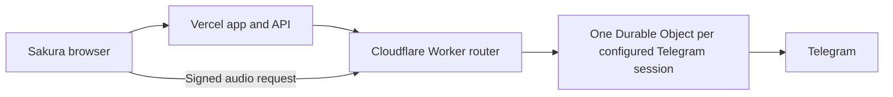

# Hosted Telegram acquisition without a card

The user approved the first option, which is now deployed on Workers Free. All five reported recordings passed complete transfer/decoding and the live Vercel resolver. See [the actual rollout](CLOUDFLARE-DOWNLOAD-ROLLOUT.md) and [operation instructions](../../worker/cloudflare/README.md).

The original research below was recorded on 2026-11-11 under the constraints of no payment card, no paid hosting budget, and no device available to keep running a service. It superseded Oracle; its pre-implementation descriptions and gates are retained as historical context.

## Recommended experiment: one Cloudflare Durable Object

There is a credible free hosted route: keep Sakura on Vercel, and move Telegram ownership into **one SQLite-backed Cloudflare Durable Object**. Ordinary Workers forward authenticated requests to that object. The object owns the Telegram transport and serializes each bot's conversation. This is a small hosted service with a different runtime, not a copy of a Node daemon into every function invocation.

Cloudflare's current documentation states:

- Durable Objects are available on **Workers Free**, using the **SQLite storage backend**. The older KV-backed backend requires paid Workers.
- The free compute allowance is **100,000 Durable Object requests/day** and **13,000 GB-seconds/day** of duration. Each object is billed at its allocated 128 MB; one object continuously active for a day is roughly 11,000 GB-seconds. That estimate fits the duration allowance, but extra objects and other limits still count.
- Workers pricing lists no additional egress/throughput charge. This is materially different from the exhausted Render bandwidth allowance; it does not mean unlimited request, CPU, storage, memory, or service availability.
- Free Durable Object storage is limited to **1 GB per object**, **5 GB per account**, with daily row-read/write limits. Store session/job metadata there, not full songs.
- Durable Object CPU defaults to **30 seconds per invocation**; the plain free Worker router has its own shorter CPU limit. Keep Telegram crypto and coordination in the object, and the routing handler minimal.
- Workers provides outbound TCP, plus Node compatibility APIs. GramJS accepts a custom `networkSocket` constructor, which is the seam for a Workers TCP-stream adapter.

This is a free-plan candidate that does not require the paid Containers plan. A live Cloudflare account/runtime check remains necessary; this investigation did not sign up or deploy.

### Why one IP is not the complete fix

Telegram's current [RPC error documentation](https://core.telegram.org/api/errors) says `AUTH_KEY_DUPLICATED` can occur when an authorization sends parallel requests through separate main TCP connections **from the same or different IPs**. Repository comments that describe only different-IP overlap are incomplete.

The default is one main session when `tmp_sessions` is absent or at most one. Telegram may explicitly allow a bounded number of parallel main sessions; those require its documented PFS/temporary-key protocol. Media-DC file-transfer sessions are a separate, permitted case. There is no general permission to create one main client per Vercel invocation.

Therefore:

- Pinning a Vercel region does not guarantee one process or one egress IP.
- A mutex held only during `connect()` does not control the live connection afterward.
- A generic TCP/HTTP proxy may consolidate addresses while leaving multiple Telegram main connections. It does not solve ownership.
- A free Cloudflare Worker proxy does not promise one static egress address.
- PFS is a real protocol feature, not an unlimited parallel-connection escape hatch. The installed GramJS contains the schema types, but no implemented temporary-key generation/binding workflow was found in its operational client code. Implementing a cryptographic authorization redesign is not the first repair to try.

The proposed Durable Object would terminate and own the Telegram protocol connection itself, rather than proxying separate clients' raw streams.

### What has been tested offline

Four private feasibility probes passed:

1. A Workers-style readable/writable TCP adapter preserves fragmented reads and outbound bytes required by GramJS.
2. Forty concurrent opens of one transport share one opening connection.
3. An ended stream rejects a request for incomplete protocol bytes instead of silently returning truncation.
4. The installed GramJS 2.26.22 dependency graph bundles for an ESM adapter: **792,032 bytes minified; 221,180 bytes gzip**, below the cited free script-size limit.

The static bundle leaves Node built-ins external. These probes **do not demonstrate Cloudflare execution, built-in runtime compatibility, Telegram login, ownership during updates, or successful song transfer**. No credentials were loaded and no Telegram connection was opened by the probes. Scripts/report: `.local/cloudflare-socket-probe.cjs` and `.local/download-root-audit/workarounds/offline-probe.*`.

### Required implementation and go/no-go checks

1. Build an isolated router and one owner class with an immutable namespace/object identity for each configured session. All app environments using that session must reach the same owner; previews must not create a second owner with the same key.
2. Use SQLite Durable Object storage and Cloudflare secrets for private session/configuration. Replace filesystem session caching with durable metadata writes. Preserve DC migration state; never expose session keys in responses/logs or the public source repository.
3. Port the existing injectable Telegram source service behind the router, preserving bearer auth, allowed bot scopes, signed document-bound audio URLs, range checks, source verification, and per-bot serialization.
4. Implement a guarded client-initialization promise and a transport owner generation. Do not create a new client for every HTTP request. Keep reconnects and all main-DC sends subject to the owner guard.
5. **Test update/eviction overlap explicitly.** Current Cloudflare lifecycle docs say old in-flight HTTP/RPC requests may finish if they do not touch storage; runtime updates can allow a 30-second drain. Unique object addressing alone is insufficient proof that an old external Telegram socket cannot overlap a new client. Use storage-backed fencing of main-connection sends, stale-client cancellation, and a deliberate reconnect/drain policy. Prove the policy in the runtime before putting the user's working authorization at risk.
6. Test the real TCP API, Node imports, GramJS crypto, deployment/restart behavior, and memory/CPU limits. Reduce download concurrency to fit Workers' outgoing-connection limits; stream with backpressure and bounded buffers instead of buffering an entire large song in 128 MB.
7. Keep the old Render owner definitively stopped before any live migration. A browser-visible suspension page alone is not a process-exit audit. Do not reactivate the same key in another process during testing.
8. Verify authenticated metadata endpoints, actual Telegram source discovery, document identity, byte ranges, cancellation, and full-download acceptance through Sakura. Reuse existing verified CDN/offline assets where possible.
9. Adapt file verification to the chosen runtime: Cloudflare cannot run the existing proposed native `ffprobe` subprocess. Use a supported JavaScript tag/container parser and, where needed, a separately tested verification stage. Do not weaken recording identity or call a checksum an acoustic fingerprint to make the migration pass.

If these checks pass, this becomes the preferred no-card deployment. If ownership or runtime checks fail, do not deploy an unsafe approximation; use the daemon alternative below or report the precise remaining limitation.

## A newer Vercel option: on-demand Daemons

The earlier statement that Vercel cannot host this worker was too broad. Current Vercel documentation includes **Daemons**, which are persistent container processes and are available on Hobby during beta. They differ from ordinary request functions.

The free Hobby daemon quotas are:

- **5 Active CPU-hours/month**.
- **420 GB-hours/month of provisioned memory**, including idle time.
- Instance sizes of **1 GiB or 2 GiB**. At 1 GiB, 420 hours is about **17.5 days of uninterrupted runtime**. A continuously running 30/31-day instance would exceed the quota; the default 2 GiB uses it twice as fast.
- Vercel stops the team's daemons when either quota is exhausted, until the next calendar month or an upgrade.

A feasible redesign is to **start one 1 GiB daemon when acquisition jobs queue, process the batch, disconnect, and scale to zero after a short idle period**. The existing Vercel API can enqueue work and poll results. This is legitimate demand-based compute; it does not multiply free accounts or conceal quota usage. It suits a personal app with modest acquisition workload, not a promise of unlimited continuous operation.

Important implementation differences:

- Daemons currently **do not accept inbound HTTP/TCP requests**. The current worker HTTP server cannot simply be deployed and called at a new URL. Change it to pull jobs from a database/queue, then publish verified results/assets for the API to consume.
- Keep exactly one main Telegram owner. Use one production daemon instance and an explicit stop-confirm-start deployment procedure. A single configured replica does not by itself establish that rolling updates never overlap.
- Daemons have no persistent local storage. Persist session/DC and job state in the existing private database or another verified available store.
- Browser playback/download needs a reachable verified asset source; it cannot connect directly to the daemon. Existing Cloudinary can be used only within its actual quota/capabilities, or a separately verified media-delivery design is required.
- Vercel app-function, origin-transfer, and CDN transfer limits remain separate. The current Hobby plan lists 100 GB Fast Data Transfer and 10 GB Fast Origin Transfer. Do not move all song delivery through the app and assume the daemon quota solves bandwidth too.
- Any scale API credentials must remain server-only. Starting/stopping resources and deployment changes await the user's plan approval.

Vercel's paid **Static IPs** product is not the free workaround: its current documentation lists Pro/Enterprise availability, $100/month per Pro project plus transfer, and a **pair** of static egress IPs per region. Even a hypothetical single address would not authorize arbitrary parallel Telegram main sessions.

## Other options checked

- **Oracle:** ruled out by the user's lack of a supported payment card.
- **Self-hosting on the user's device:** ruled out by the user's requirement for hosted service.
- **Hugging Face Docker Spaces:** current overview says creating Docker/Gradio compute Spaces requires a paid plan. The displayed CPU Basic hardware rate is zero, but that does not make creation available to a new free account. The free ZeroGPU exception is for eligible Gradio Spaces and is not a persistent Node-worker host. Older “free Docker Spaces” advice is unsuitable without confirming an existing account's eligibility.
- **ngrok/Tailscale/Cloudflare tunnels:** require a computer or service behind the tunnel. A tunnel does not provide the missing always-running worker, and free transport limits must be assessed separately.
- **Telegram Bot API:** a bot token is not a drop-in substitute for the authenticated user's interaction with the existing music bot. Do not assume it provides access to the same conversations/files.

## Recommended next step

Proceed with the **Cloudflare Durable Object runtime proof**, followed by migration only if the transport/ownership gates pass. Keep the **on-demand Vercel Daemon** design as a second route if compatible durable media delivery is available within the user's existing quotas. Both are credible hosted designs under the no-card constraint; neither has been certified live yet.

The original song-identity repair plan remains necessary after hosting: truncated metadata, version parsing, integrity checks, and complete-save acceptance do not disappear with a different host.

## Primary sources

Retrieved on 2026-11-11:

- [Cloudflare Durable Objects pricing and Free/SQLite availability](https://developers.cloudflare.com/durable-objects/platform/pricing/)
- [Durable Object limits](https://developers.cloudflare.com/durable-objects/platform/limits/)
- [Durable Object lifecycle, old requests, and updates](https://developers.cloudflare.com/durable-objects/concepts/durable-object-lifecycle/)
- [Durable Object design rules](https://developers.cloudflare.com/durable-objects/best-practices/rules-of-durable-objects/)
- [Workers outbound TCP API](https://developers.cloudflare.com/workers/runtime-apis/tcp-sockets/)
- [Workers Node net compatibility](https://developers.cloudflare.com/workers/runtime-apis/nodejs/net/)
- [Workers Node crypto compatibility](https://developers.cloudflare.com/workers/runtime-apis/nodejs/crypto/)
- [Workers pricing, egress, and free-plan limits](https://developers.cloudflare.com/workers/platform/pricing/)
- [Vercel Daemons](https://vercel.com/docs/daemons) and [daemon limits](https://vercel.com/docs/daemons/limits)
- [Vercel Hobby quotas](https://vercel.com/docs/plans/hobby)
- [Vercel Static IPs](https://vercel.com/docs/connectivity/static-ips)
- [Telegram RPC errors and main-session restrictions](https://core.telegram.org/api/errors)
- [Telegram parallel sessions](https://core.telegram.org/api/datacenter#parallel-sessions)
- [Telegram PFS and temporary-key binding](https://core.telegram.org/api/pfs)
- [Hugging Face Spaces overview and creation requirements](https://huggingface.co/docs/hub/spaces-overview)

Private retrieved source text and timestamps are retained in `.local/download-root-audit/vercel/`, `workarounds/`, and `no-card/`.
